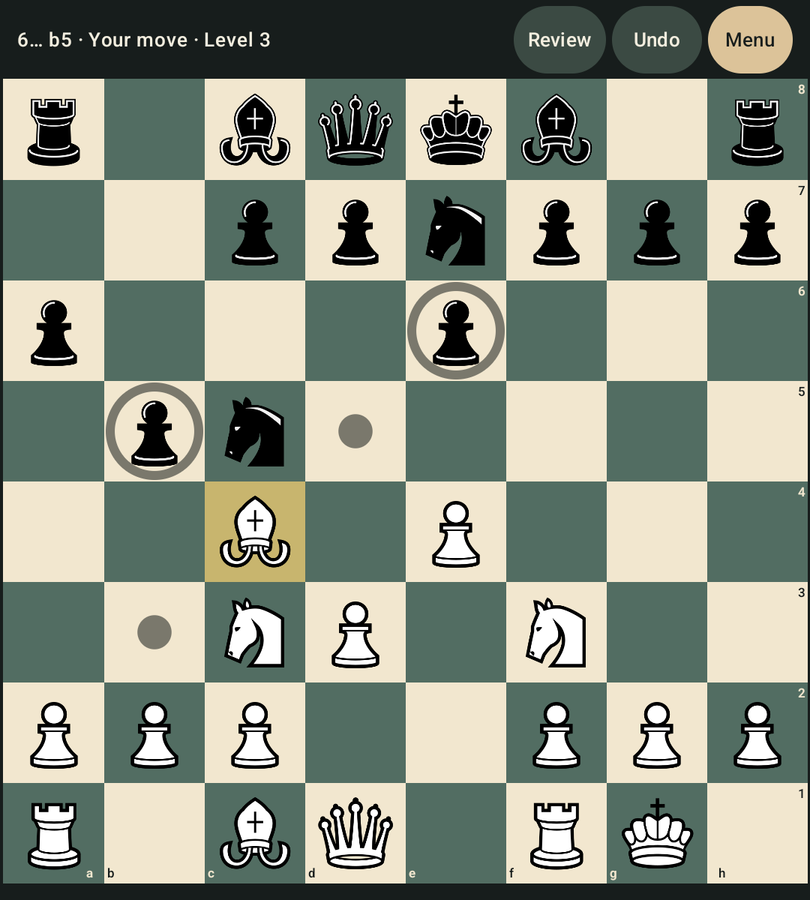
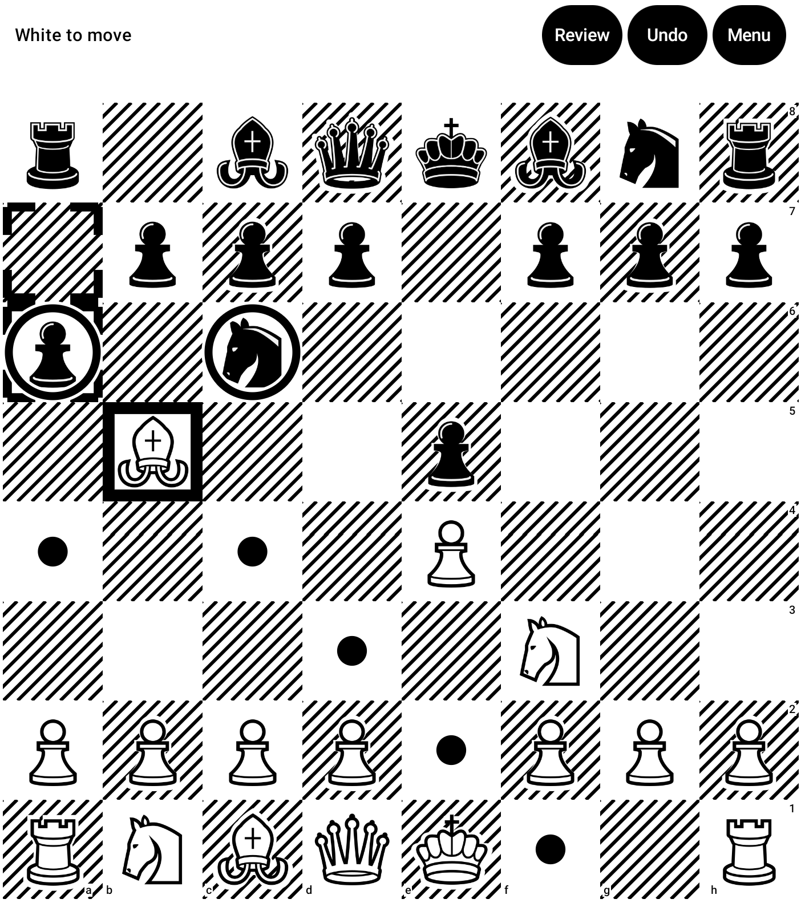
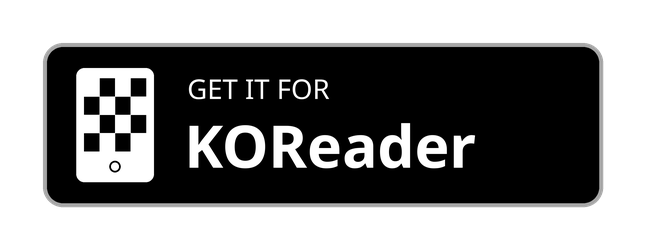
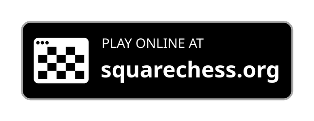
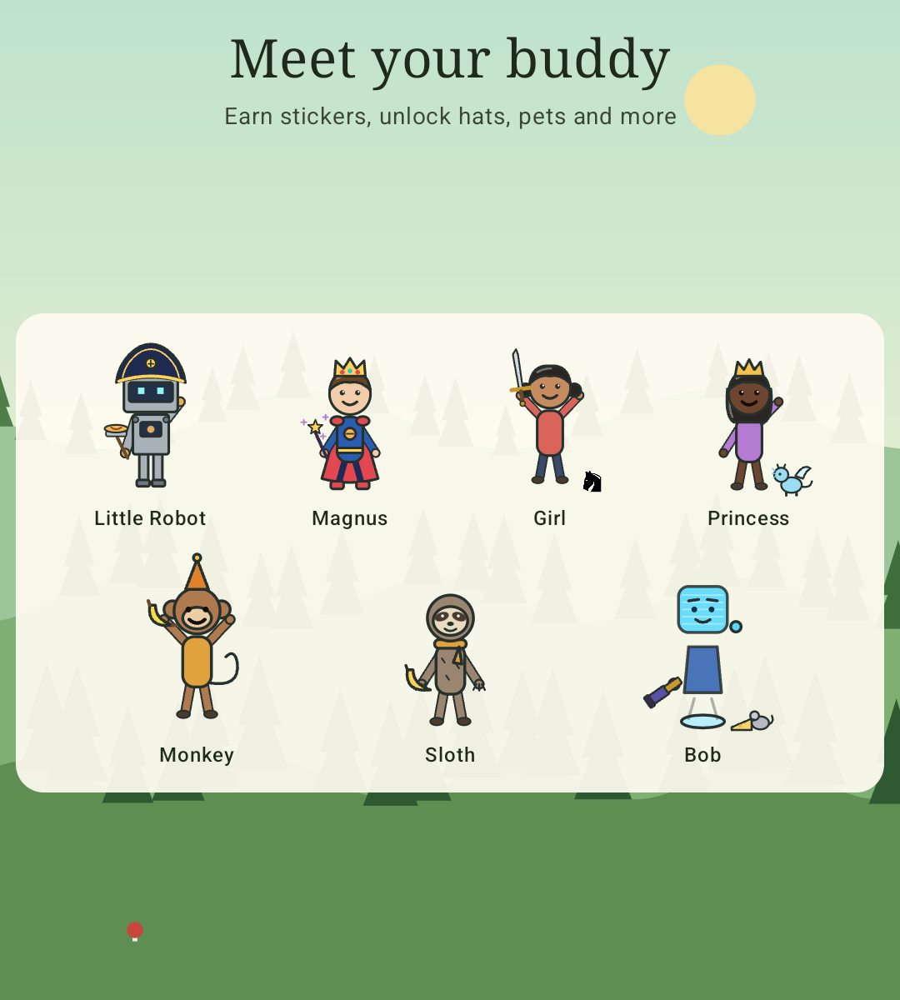
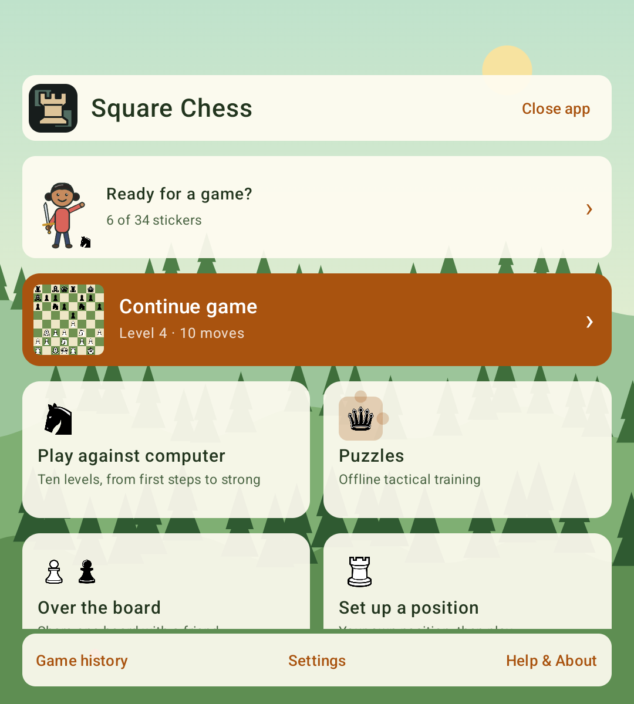
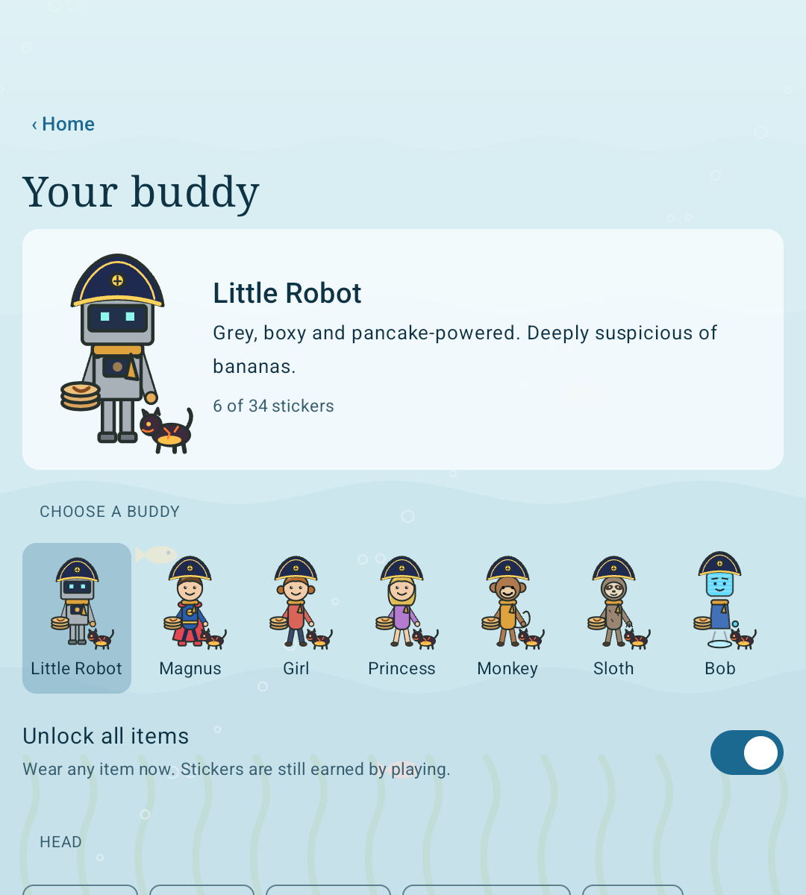

# Square Chess

**Chess built for square screens, compact devices, e-ink and physical keyboards.**

> Square Chess is an offline Android chess app designed for hardware that conventional chess apps often do not use well — while still working on ordinary phones and tablets.

<table>
<tr>
<td align="center"><strong>Compact & square screens</strong></td>
<td align="center"><strong>E-ink mode</strong></td>
</tr>
<tr>
<td></td>
<td></td>
</tr>
</table>

<a href="https://play.google.com/store/apps/details?id=com.dataespresso.squarechess"></a> <a href="https://github.com/chriotte/square-chess/releases/latest"></a> <a href="https://f-droid.org/packages/com.dataespresso.squarechess/"></a> <a href="https://github.com/chriotte/squarechess.koplugin"></a> <a href="https://squarechess.org"></a>

The KOReader badge leads to the same game for e-readers that cannot run Android apps: jailbroken Kindles, Kobo, PocketBook and reMarkable. To play in a browser on any computer, tablet or phone, go to [squarechess.org](https://squarechess.org).

## Why Square Chess?

The board comes first.

Square Chess makes the chessboard as large as possible and fits the interface around the space that remains.

- **Square & compact screens** — designed around unusual screen shapes instead of assuming a tall phone.
- **E-ink displays** — dedicated black-and-white mode with hatched squares, shape-based highlights and no animations.
- **Physical keyboards** — play by typing moves such as `e4`, `Nf3`, `O-O` or `e2e4`.
- **Offline & private** — no ads, no analytics, and no account needed. Sign-in to sync is optional.

It also works normally on conventional Android phones and tablets.

## Play chess your way

- **Play against the computer** at ten difficulty levels, from beginner-friendly play to full-strength Fairy-Stockfish.
- **Solve puzzles**: 10,000 offline tactics puzzles from the Lichess puzzle database, with themes, a quick set of five, and review of the ones you miss.
- **Play with a friend** on the same device, with an optional chess clock.
- **Record a real-board game** and review it afterwards move by move.
- **Use touch or keyboard input** — tap, drag or type your moves.
- **Review and manage games** with move history, undo, resign and draw handling.
- **Import and export PGN** for Lichess, ChessBase and other chess software.

- **Set up a position** — place the pieces yourself, then play it against the computer or a friend.

Square Chess also includes a standalone chess clock, board customisation, coordinates, legal-move markers, move sounds and vibration.

## Playful extras

Turn on **Playful extras** in Settings for a more colourful game. Pick a world (Forest, Banana Jungle, Ocean or Space) and a buddy who cheers you on when you solve a puzzle, says "try again" after a mistake, and comments on your games against the computer on bigger screens. Earn stickers for your first checkmate, puzzle streaks and wins, and unlock hats, swords, wands and pets for your buddy. Magnus, the Girl and the Princess can have their skin tone and hair colour chosen.

Playful extras are off by default, the buddy never makes the board smaller, and e-ink mode stays calm black and white.

<table>
<tr>
<td align="center"><strong>Meet the buddies</strong></td>
<td align="center"><strong>Home with a world</strong></td>
<td align="center"><strong>Dress up your buddy</strong></td>
</tr>
<tr>
<td></td>
<td></td>
<td></td>
</tr>
</table>

## Private and offline

Everything runs locally on your device, and the app works fully offline.

**No ads. No analytics. No account needed.**

You can sign in to an optional squarechess.org account to sync games, puzzles and ratings between devices. The app uses the Internet permission only for that, and only after you sign in. Without an account, your games and settings stay on your device, and you can still save everything to a backup file.

See the [privacy policy](PRIVACY_POLICY.md) (also at [squarechess.org/privacy](https://squarechess.org/privacy)).

## Installation

- **Google Play:** [Square Chess on Google Play](https://play.google.com/store/apps/details?id=com.dataespresso.squarechess)
- **GitHub:** [Download the latest release](https://github.com/chriotte/square-chess/releases/latest) — signed APK with its SHA-256 checksum
- **F-Droid:** [Square Chess on F-Droid](https://f-droid.org/packages/com.dataespresso.squarechess/)
- **E-readers (KOReader):** [Square Chess for KOReader](https://github.com/chriotte/squarechess.koplugin) — for jailbroken Kindles, Kobo, PocketBook and reMarkable, which cannot run Android apps

Google Play and GitHub/F-Droid builds are signed with different keys, so they cannot update one another directly.

To move between builds:

1. Export your games from **Game history → Export**
2. Install the other build
3. Import them using **Game history → Import**

## Supported devices

Square Chess requires:

- Android 8.0 (API 26) or newer
- ARM64

It is developed and tested on the **Unihertz Titan 2 Elite** and an **Onyx Boox Note3** e-ink tablet, with additional testing for other screen sizes and physical-keyboard devices.

It also works on conventional Android phones and tablets.

See the [device testing plan](docs/testing/test-plan.md).

### E-readers that cannot run Android

Kindles, Kobo, PocketBook and reMarkable run Linux rather than Android, so the app cannot be installed on them. **[Square Chess for KOReader](https://github.com/chriotte/squarechess.koplugin)** is a port of it as a [KOReader](https://koreader.rocks) plugin, with the same engine and levels, the same 10,000 puzzles and the same e-ink board. It adds a chess clock for games on a real board, and takes pen input as well as touch.

It is developed in [koreader/](koreader/) in this repository and published from that one, where you can install it from a release zip, from the Storefront plugin store on the device, or on a jailbroken Kindle with `kpm install squarechess`.

## Building from source

Requirements:

- JDK 21
- Android SDK, platform 36
- Android NDK 28.2.13676358
- CMake 3.22.1

Build and run the checks with:

```sh
./gradlew check assembleDebug
```

See [Building from source](docs/development/building.md) for full instructions, and [Architecture](docs/architecture/overview.md) for an overview of the project structure.

## Chess engine

Square Chess uses [Fairy-Stockfish](https://github.com/fairy-stockfish/Fairy-Stockfish) with classical evaluation.

The engine is based on the version pinned by the Lichess mobile project's [multistockfish](https://github.com/lichess-org/dart-multistockfish) package and is compiled from source in [`native/fairy/`](native/fairy/).

Difficulty levels use Fairy-Stockfish's own **Skill Level** and **MultiPV** settings rather than a custom move-weakening algorithm.

See the [engine documentation](docs/engine/) for calibration and implementation details.

## Contributing

Contributions, bug reports and suggestions are welcome.

See:

- [CONTRIBUTING.md](CONTRIBUTING.md)
- [SECURITY.md](SECURITY.md)

## Author

Square Chess is designed and built by **Christopher Ottesen**.

If you want to support development, you can donate on [Ko-fi](https://ko-fi.com/chriotte) or [Liberapay](https://liberapay.com/chriotte).

## Licence

Square Chess is free software licensed under the [GNU General Public License v3.0 or later](LICENSE).

Third-party components and their licences are documented in [THIRD_PARTY_LICENSES.md](THIRD_PARTY_LICENSES.md).

Google Play and the Google Play logo are trademarks of Google LLC. The GitHub download badge is by @flocke under CC BY-SA 3.0 ([details](docs/images/badges/README.md)).
