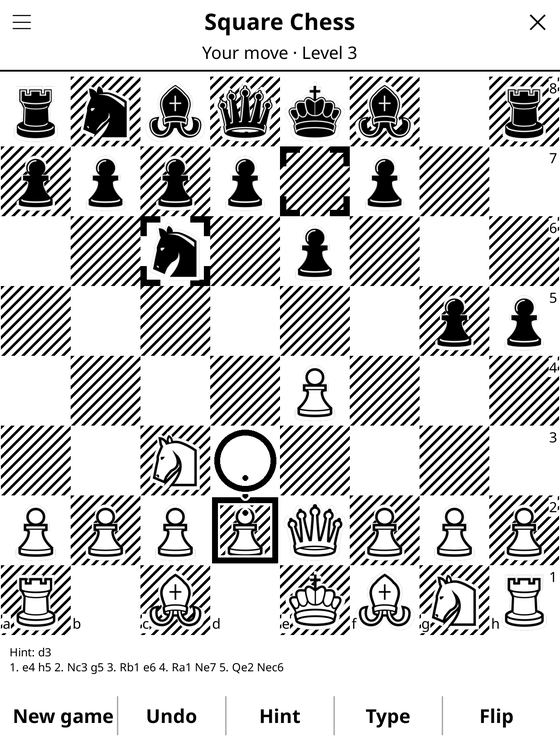
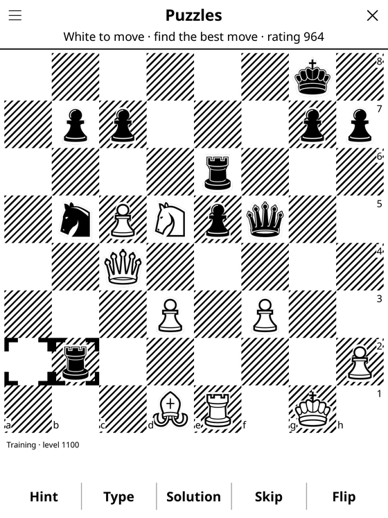
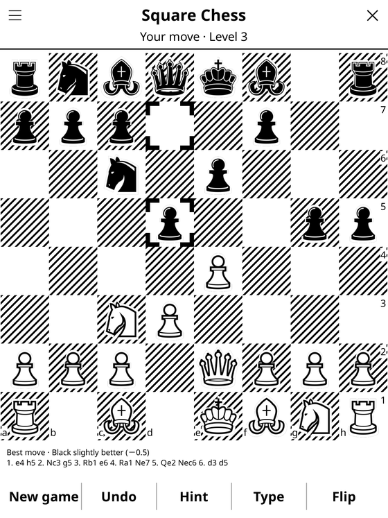
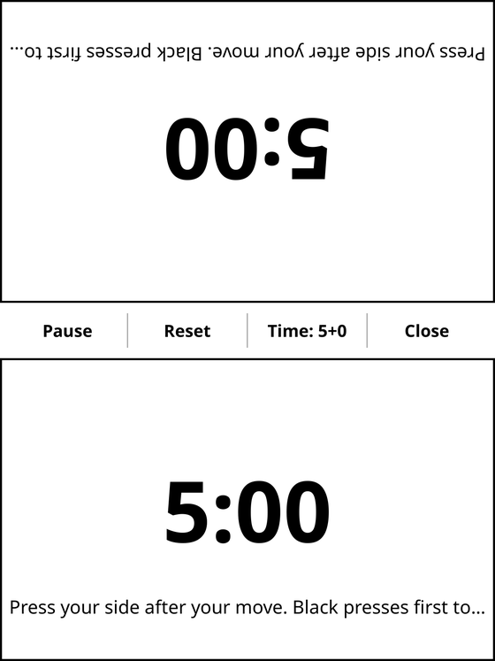

# Square Chess for KOReader

Offline chess for e-ink readers: play Fairy-Stockfish at ten levels, play a friend on the same device, solve 10,000 puzzles, or use the chess clock for a game on a real board. Everything runs on the device. Nothing is ever sent anywhere.

It is a port of [Square Chess](https://github.com/chriotte/square-chess), an Android app, for readers that cannot run Android apps: jailbroken Kindles (including the Scribe), Kobo, PocketBook and reMarkable.

<p>
  
  
</p>

## Why it looks like this

E-ink is black and white, slow to redraw and awkward with small detail, so the board is drawn for it rather than scaled down from a colour one:

- Dark squares are **hatched**, not grey, so they stay distinct after a partial refresh.
- Highlights are **shapes, not colours**: a box around the piece you picked up, dots on the squares it can reach, corner marks on the last move, a ring on a hint's target.
- Nothing animates, and only the part of the screen that changed is redrawn.

## What it does

- **Play the computer** at ten levels, as White, Black or a random colour
- **Two players** on one device
- **Time controls** from 1+0 to 30+0, with a clock bar you tap to pause. Flagging loses, unless the opponent has no material to mate with
- **Hints**: the engine's move drawn on the board
- **Evaluation**, if you want it: who is ahead, every move labelled Best, Good, Inaccuracy, Mistake or Blunder, and a summary at the end
- **Review** any game move by move, and carry on playing from any position in it
- **Puzzles**: 10,000 Lichess puzzles, picked to match your level, with themes, Quick 5, two-step hints, show-solution, and missed puzzles returning after 0, 3, 7 and 30 days
- **Chess clock** for games on a real board: two halves facing each other, ten presets, increment, pause
- **PGN**: open a file and pick a game from it, or save the one you are playing
- **Moves by tap, drag or typing** (`e4`, `Nf3`, `O-O`, `e2e4`), with the on-screen keyboard or a real one
- The full draw rules: automatic draws for dead material, fivefold repetition and the 75-move rule; claimable draws for threefold and the 50-move rule
- Games and puzzle progress are saved as you go. Portrait and landscape both work

<p>
  
  
</p>

## Pen input

A pen is treated as a finger, and the board is forgiving about what that means in practice. A pen tap that slides a little is still a tap. A slow press still counts. A stroke from one square to another moves the piece. Nothing needs a long press or a double tap.

## Install

**With [Storefront](https://github.com/ultimatejimmy/storefront.koplugin)**, the plugin store that runs on the device: search for Square Chess and install it.

**On a jailbroken Kindle**, type this in the home screen search bar:

```
;kpm install squarechess
```

**By hand**, on any device: download `squarechess.koplugin-<version>.zip` from [Releases](https://github.com/chriotte/squarechess.koplugin/releases) and unzip it into KOReader's `plugins` folder, so that you end up with `plugins/squarechess.koplugin/`.

| Device | Folder |
|---|---|
| Kindle | `koreader/plugins/` |
| Kobo | `.adds/koreader/plugins/` |
| Others | the `plugins` folder beside KOReader's `reader.lua` |

Then restart KOReader and open **Tools → Square Chess**. Each mode can also be put on a gesture, under **Settings → Taps and gestures**.

Tested on KOReader v2026.07.1, on a Kindle Paperwhite 11th generation and in KOReader's emulator at Kindle Scribe, Paperwhite and landscape sizes.

## How it fits together

| File | What it does |
|---|---|
| `chess.lua` | The rules: legal moves, SAN, FEN, how a game ends. Pure Lua, no KOReader |
| `pgn.lua`, `clock.lua`, `evaluation.lua`, `puzzles.lua` | PGN, clock, move labels, puzzle training. Also pure Lua |
| `engine.lua` | Runs Fairy-Stockfish as a child process and speaks UCI to it without blocking the UI |
| `board.lua` | Draws the board and turns touch and pen gestures into moves |
| `gamescreen.lua`, `puzzlescreen.lua`, `clockscreen.lua` | The three screens |
| `ui.lua` | Shared parts: the promotion and typed-move dialogs, the clock bar |
| `main.lua` | Menu entries and gesture actions |

Those are all in `squarechess.koplugin/`. The engine source is in `engine/`, and `tools/` builds the binaries, the piece images and the release zip.

## Building

```sh
tools/build-engine.sh       # static engine binaries, needs podman or docker
tools/package.sh            # the install zip, in dist/
```

The engine binaries are statically linked, so one `armhf` build runs on every 32-bit ARM reader whatever its C library or float ABI. The plugin picks the binary matching `uname -m`.

## Tests

```sh
# Rules, PGN, clock, evaluation, puzzles: perft on six standard positions and a
# replay of all 10,000 puzzles. Needs LuaJIT, or KOREADER_DIR pointing at an
# unpacked KOReader build.
KOREADER_DIR=/path/to/koreader tests/run.sh

# The engine bridge, against the real binary.
cd /path/to/koreader && ./luajit <repo>/tests/engine_check.lua

# All three screens, driven through KOReader's own gesture dispatch, including
# pen-style gestures. Screenshots are written to <out>.
cd /path/to/koreader && SDL_VIDEODRIVER=offscreen KO_HOME=/tmp/ko-test \
    EMULATE_READER_W=1860 EMULATE_READER_H=2480 EMULATE_READER_DPI=300 \
    ./luajit <repo>/tests/ui_check.lua <out>
```

## Licence

GPL-3.0-or-later, like Fairy-Stockfish and the Android app. KOReader itself is AGPL-3.0-or-later; a GPL-3.0 plugin may be combined with it under section 13 of both licences.

The engine binaries in `bin/` are built from `engine/`, which is the corresponding source the GPL requires; `engine/PROVENANCE.md` records exactly which upstream commits it came from and what was changed. The piece artwork is Chessnut by Alexis Luengas, Apache-2.0, with a white halo added for e-ink. The puzzles come from the Lichess puzzle database (CC0).
